# vMix IO System Guide

## Introduction

vMix IO is software that runs on Windows or Linux. It is designed to convert live video and audio signals between a compatible capture card and the Open Media Transport (OMT) protocol.

The following provides instructions to build a compact computer to handle a total of **8x 1080p60 signals**. 

In order to achieve the small form factor, a Mini-ITX motherboard, Flex ATX PSU and PCIe riser cable have been used. A 3D-printed custom case has been designed for housing these specific components. If building in a larger case, consider using more cost-effective components.

## What you will need

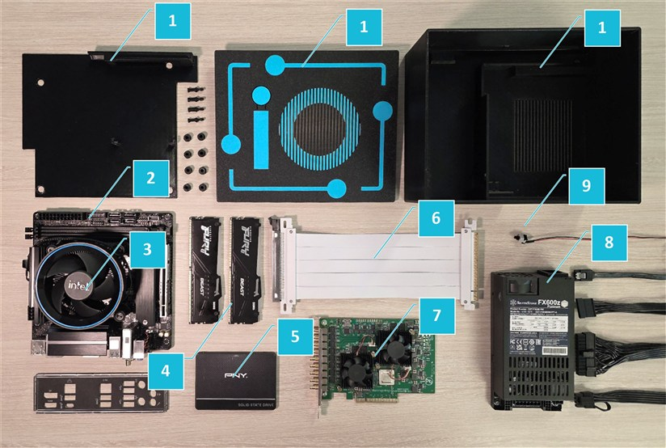

| # | Part | Details | Link |
|---|------|---------|------|
| 1 | Case | 3D printed case components | [STL files](stl/) |
| 2 | Motherboard | ASRock B860i WiFi | [Amazon](https://www.amazon.com/ASRock-LGA1851-B860I-WiFi-Motherboard/dp/B0DRTW765T?crid=11ZHZRRWBEZWU&dib=eyJ2IjoiMSJ9.bcVAPBTGvAxf29inyfZrPu_6XeqPv_GVaEVQWmh1dpMI9ukptkTaUHM9F75qlYaaERUyWukpohp4H4FyAxEkV5ERUbdD4wb7ZiS-5I0SslK_Qrgp7IgcDbaIJT_nYHBuRR6ctnx9xYL1p492MLiPs2TVZI36BRINalhEVIr0yIATsAk2bD_wI5fty0qXMUf-j8Y_PRVsVUHDHEvkf9l7O8D5NmIsNd_zpd5lxLmuPlU.LTTtlOSyYImASCFi34JY4IqbZm-5FKMDrdHaGOY-Z7Q&dib_tag=se&keywords=asrock%2Bb860i%2Bwifi&qid=1791409616&sprefix=asrock%2Bb860i%2Bwif%2Caps%2C319&sr=8-1&th=1) |
| 3 | CPU | Intel Core Ultra 5 225 with included stock cooler | [B&H Photo](https://www.bhphotovideo.com/c/product/1860687-REG/intel_bx80768225_core_ultra_5_225.html) |
| 4 | RAM | Kingston Fury Beast DDR5 2x8GB | [Amazon](https://www.amazon.com/Kingston-Technology-5600MT-Computer-KF556C40BBK2-16/dp/B09T8VWV2R?crid=35E0YSM5LSNE3&dib=eyJ2IjoiMSJ9.mOc6G1Gthj9ANu0WvV2RssHPFD9vKYoCxtrT6s--ROACDeLdExU_YtdiKGNMboMUxpBZ7PzisO1B2CBsWEEQ0ZYtMk4_CWxrG6ZdjazbME0tF1_PQWQg6FyX3EnJNLpSwwy4wtowcfw8-sm21PSMatwItvbmaquBqEtigm0kH_2O5ubQT9vIaUjLOT3RkCLMqYxDgvQgllJyl9KDscqG7FP_9A91zQ5qmKjX9HBOsHU.hbqZkN1kS8j1ZyULTN-GY59SQEltt_7EncTeJUtUzkE&dib_tag=se&keywords=kingston%2Bfury%2Bddr5&qid=1791421872&sprefix=kingston%2Bfury%2Bdd%2Caps%2C344&sr=8-11&th=1) |
| 5 | SSD | PNY 250GB 2.5" drive, including SATA cable | [B&H Photo](https://www.bhphotovideo.com/c/product/1523158-REG/pny_technologies_ssd7cs900_250_rb_250gb_cs900_ssd.html) |
| 6 | PCIe riser cable | Straight (180 Degree) 200mm PCIe 4.0 | [Amazon](https://www.amazon.com/EZDIY-FAB-Bandwidth-Extension-Compatible-Straight-20cm/dp/B0FCLC8L9B/136-7500014-9714316?pd_rd_w=aFVcH&content-id=amzn1.sym.751acc83-5c05-42d0-a15e-303622651e1e&pf_rd_p=751acc83-5c05-42d0-a15e-303622651e1e&pf_rd_r=9HTH9563XZH9NC3EHJFG&pd_rd_wg=CKsLg&pd_rd_r=5af529d2-92f9-4ec1-8e53-c57640d3f663&pd_rd_i=B0FCLC8L9B&th=1) |
| 7 | Capture card | BMD DeckLink Quad 2 - 8x 1080p60 SDI | [B&H Photo](https://www.bhphotovideo.com/c/product/1186263-REG/blackmagic_design_bdlkdvqd2_decklink_quad_2_8_channel.html) |
| 8 | PSU | Silverstone FX600Z 600W modular Flex ATX power supply, including power cables | [Amazon](https://www.amazon.com/Silverstone-Technology-Platinum-Cybenetics-SST-FX600-PM/dp/B0FWJ2Z571?crid=36PGHVX1R5ANM&dib=eyJ2IjoiMSJ9.Q266aY8Qc0x6HRC8lMid_DJAx6XmPgDPfSn6k8Hom6MmSGIpa2u4iAqbPhji0eQBJ4u0dSoOJY0sivrriP3UG-jhBKro_uwCeddZJKGTOdpL-Z37Dn7pFtJGJbuIVYORXZeLK4JXdbxbpnMQYjHUJAU8wiLWVi-w6v6X5lfvOcU2rhMVABPZTHo9UTbCd6Fx9OC3MVRhkbeXwS-jxhrBcaOtaszR1OQmRAZWpEomJjU.Tq7vM8YyCTVG7VTQGk5cftIkR8nKiOsj5ZyoJxKy_Xo&dib_tag=se&keywords=silverstone+fx600z&qid=1791409236&sprefix=silverstone+fx600%2Caps%2C327&sr=8-1) |
| 9 | Power switch | 2-Pin momentary PC case power switch | [Amazon](https://www.amazon.com/Warmstor-3-Pack-Desktop-Button-Computer/dp/B072FMVZJZ?crid=2D0AKLEU9PIQH&dib=eyJ2IjoiMSJ9.29HCPsSFQrT229xxTyaDRN8wamUWzI-ag0uEwfo7HJCASGOO5b2Kqlsdm69KD5L3564IweYwkWrvzu4QTM96s_1NlmDpasO2-cqjIXn6fgdJTqLHChEaTLE-pOt7CwqcVBCP_wTjNaaopcdBDFjvvc6QoptQDlNho1HnlKuncoAita_bRf-VqscqQpsFSzqtQi2ntiq-tHQKF8b7R7Jep_0du757HvaIlR1tR4xmHok.DmeIIX0i5amVfGg8mPl4-_ho4ZI11F15LitkUmxiuiw&dib_tag=se&keywords=pc+power+switch&qid=1791409109&sprefix=pc+power+swit%2Caps%2C331&sr=8-5) |

## Assembly

### 1. Print the case components

Printer used: Bambu Lab A1 with AMS (for multi-colour).

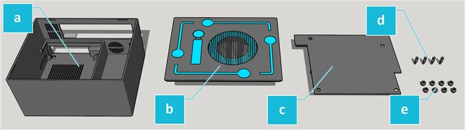

| Label | Qty | Part | Material | Print settings | STL (Rev1.0) |
|:-----:|:---:|------|----------|----------------|--------------|
| a | 1 | Case | PETG, single colour | Print upright, Supports on | [vMix-IO-Case-Rev1.0.stl](stl/vMix-IO-Case-Rev1.0.stl) |
| b | 1 | Lid | PETG, dual colour | Print face down, supports off | [vMix-IO-Lid-Rev1.0.stl](stl/vMix-IO-Lid-Rev1.0.stl) |
| c | 1 | Motherboard plate | PETG, single colour | Print face down, supports off | [vMix-IO-Plate-Rev1.0.stl](stl/vMix-IO-Plate-Rev1.0.stl) |
| d | 4 | Pins | PETG, single colour | Print pointing up, supports off | [vMix-IO-Pin-Rev1.0.stl](stl/vMix-IO-Pin-Rev1.0.stl) |
| e | 8 | Standoffs | TPU, single colour | Print pointing down, supports off | [vMix-IO-Standoff-Rev1.0.stl](stl/vMix-IO-Standoff-Rev1.0.stl) |

The Pin and Standoff STLs are single parts, so print the quantities listed above.

### 2. Fit the motherboard plate standoffs

Press 4x TPU standoffs into the 4x holes on the flat side of the motherboard plate.

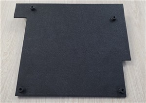

### 3. Fit the case feet

Press 4x TPU standoffs into the 4x holes on the underside of the case to form feet.

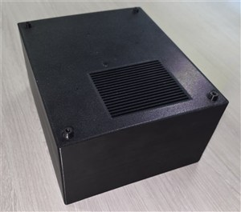

### 4. Attach the PCIe riser to the capture card

With the DeckLink Quad 2 upside-down, connect the PCIe riser cable and bend the cable upwards.

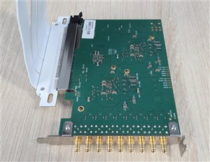

### 5. Install the capture card

Install the DeckLink Quad 2 by sliding the PCIe mounting bracket into the slots in the case. Ensure the card is pushed to the back of the case so that it sits flat and the bracket is nearly flush with the outside of the case (**a**).

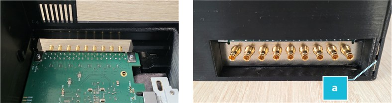

### 6. Connect the power supply cables

Connect the following cables to the power supply:

- Motherboard
- CPU
- SSD power
- *If using a powered capture card, also install a PCIe cable*

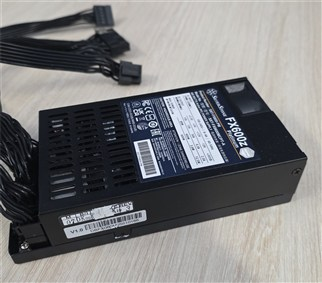

### 7. Install the power supply

Install the power supply, ensuring the power cable surround fits flush with the case cut-out (**a**).

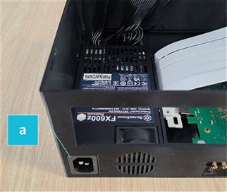

### 8. Prepare the cables

- **(a)** Run the motherboard power cable up.
- **(b)** Flex the PCIe riser over the capture card, then flex up at the wall.
- **(c)** Run the remaining power supply cables along the channel (keeping below the height of the power supply and ridge) and then up at the wall together with the PCIe riser.

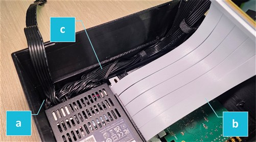

### 9. Connect the SSD cables

Connect the SATA and power cable to the SSD.

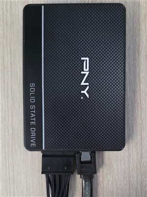

### 10. Clip the SSD into the motherboard plate

Position the motherboard plate with the flat side facing away and the protrusion at the top, then clip the SSD into the space provided.

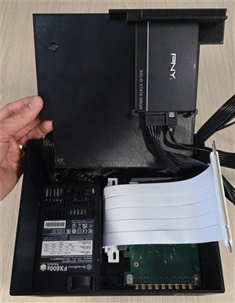

### 11. Install the motherboard plate

Lift the motherboard plate up and then rotate it down beyond 90 degrees, positioning the plate-top on the inner wall ledge above the capture card ports (**a**). Then hinge the plate down and clip it into the remaining wall ledges (**b**).

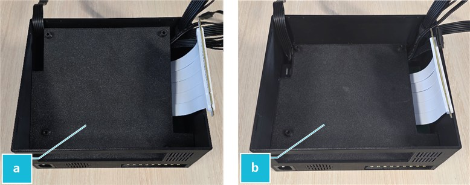

### 12. Check the plate is seated correctly

If the above is completed correctly:

- The motherboard plate should be sitting level and hard against the power supply.
- The cables should be running up the voids around the plate.
- The plate underside protrusion should be sitting over the capture card to hold it in place.

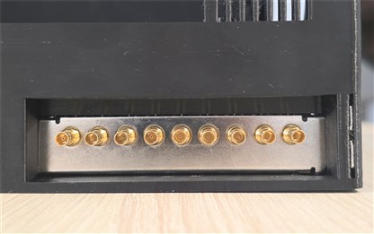

### 13. Install the motherboard back plate

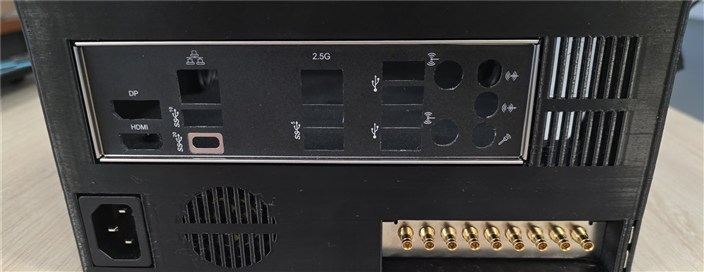

### 14. Install the RAM, CPU and CPU cooler

Install these onto the motherboard.

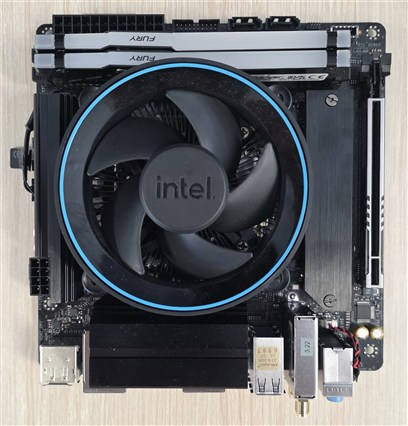

### 15. Mount the motherboard

Place the motherboard onto the standoffs on the motherboard plate and align it with the back plate and the screw holes. Then push a pin into each of the four holes, ensuring each one clicks into place.

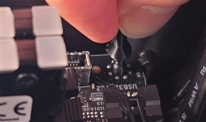

### 16. Install the power switch

Install the power switch into the case lid.

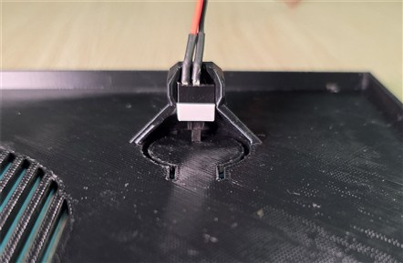

### 17. Connect the motherboard, SATA and power switch cables

Connect the motherboard (**a**), SATA (**b**) and power switch (**c**) cables to the motherboard.

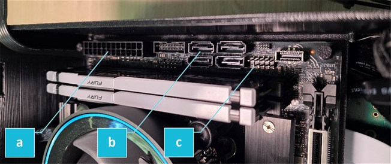

### 18. Connect the CPU power and PCIe riser cables

Connect the CPU power (**a**) and the PCIe riser (**b**) cables to the motherboard.

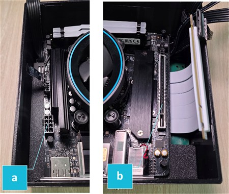

### 19. Tidy the cables

Ensure cables are tidy and secure.

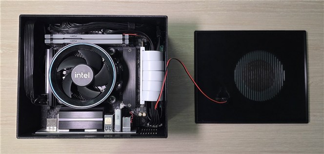

### 20. Fit the lid

Fit the lid, ensuring that the CPU fan aligns with the ventilation slots.

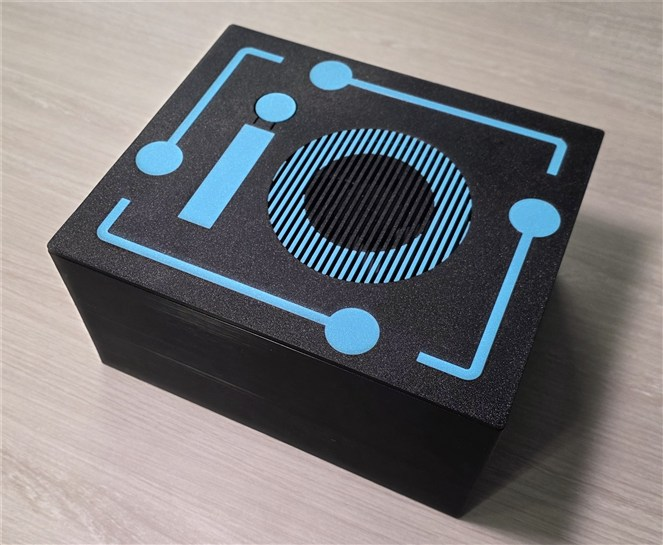
